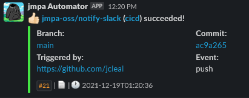

<!-- markdownlint-disable MD041 MD010 MD034 -->
[](https://github.com/jmpa-io/post-to-slack/actions/workflows/./README.yml)[](https://github.com/jmpa-io/post-to-slack/actions/workflows/./cicd.yml)

<p align="center">
  
</p>

# ``

```diff
+ 🐋 A GitHub Action for sending notifications from running jobs to Slack (via
+ a given webhook).
```

* Inspired by [`action-slack` by `8398a7`](https://github.com/8398a7/action-slack); Created using [this doc](https://docs.github.com/en/free-pro-team@latest/actions/creating-actions/creating-a-docker-container-action) from GitHub.

## `usage`

General:

```yaml
- name: Post to Slack.
  uses: jmpa-io/post-to-slack@main
  with:
    webhook: ${{ secrets.SLACK_WEBHOOK_URL }}
    status: ${{ job.status }}
```
Posting as a bot instead of a webhook:

```yaml
- name: Post to Slack.
  uses: jmpa-io/post-to-slack@main
  with:
    token: ${{ secrets.SLACK_BOT_TOKEN }}
    channel: C0123456789
    status: ${{ job.status }}
```

> If you're unsure how to create the `${{ secrets.SLACK_WEBHOOK_URL }}`, see [this doc from Slack around creating a custom Slack App for your Slack workspace](https://api.slack.com/messaging/webhooks).

> If you want the status of a whole workflow (not just the current job), run this from a final job with `needs: [...]` and `if: always()`, and derive it from `needs.*.result` (see [`99-post-to-slack`](https://github.com/jmpa-io/pipelines/blob/main/.github/workflows/99-post-to-slack.yml) in `jmpa-io/pipelines`, which does this for you when you pass `needs: ${{ toJSON(needs) }}`).

With if conditionals ([see doc](https://docs.github.com/en/free-pro-team@latest/actions/reference/context-and-expression-syntax-for-github-actions#job-status-check-functions)):

```yaml
- name: Post to Slack.
  if: success() # accepts: success(), always(), cancelled(), failure()
  uses: jmpa-io/post-to-slack@main
  with:
    webhook: ${{ secrets.SLACK_WEBHOOK_URL }}
    status: ${{ job.status }}
```

## `inputs`

### (optional) `webhook`

The Slack webhook to post to. This is created / managed
by a custom Slack App in your Slack workspace. Required unless `token` and
`channel` are given instead.

### (optional) `token`

A Slack bot token (`xoxb-...`) with the `chat:write` scope. Used with `channel`
when no `webhook` is given.

### (optional) `channel`

The id of the Slack channel to post to (eg. `C0123456789`). Used with `token`.
The bot must be a member of the channel, or have `chat:write.public`.

### (required) `status`

The status of the running GitHub Action job (`success`, `failure` or `cancelled`).
